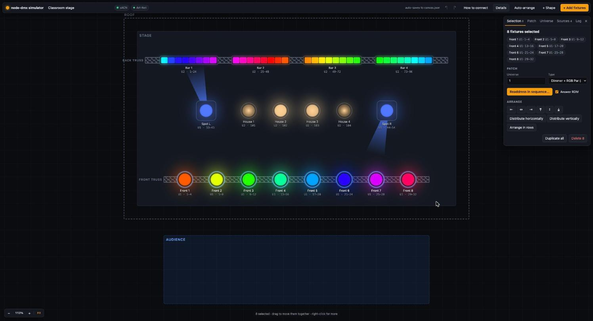

# node-dmx-simulator

Test your DMX code without real lights. The simulator acts like DMX
fixtures on your network: it receives **sACN** and **Art-Net**, answers
**Art-Net discovery** and **RDM**, and shows what your lights would do in a
browser.



- Lay out a virtual stage: pars, LED bars, pixel strips, moving heads, dimmers
- Drag fixtures around and change their patch in the browser. Select several to move, align, readdress or delete them together; right-click for more. Undo with ⌘Z / Ctrl+Z. Edits are saved to a JSON rig file
- See each fixture's channel values, a 512-channel view of each universe, and who is sending
- Warnings for overlapping patches, sync problems and multiple senders
- RDM: list fixtures, read their info, identify them and readdress them from your code
- Works with any sACN or Art-Net software; built on (and made for testing) [node-dmx](https://github.com/Datalab-Rotterdam/node-dmx)
- The web UI is a small SvelteKit app in [`ui/`](ui) that you can extend

## Start

You need [Node.js](https://nodejs.org) 20 or newer. Then:

```bash
npx node-dmx-simulator
```

Open <http://localhost:8080> (or add `--open`). The simulator creates
`dmx-rig.json` in the current folder from the `examples` rig: four 5-channel
RGBWW pars on universes 1–4, address 1. That's the layout the
[node-dmx examples](https://github.com/Datalab-Rotterdam/node-dmx/tree/main/examples)
use, so in a checkout of node-dmx try:

```bash
npm run example/sacn-rainbow
npm run example/artnet-animate
```

Other bundled rigs:

```bash
npx node-dmx-simulator --rig classroom   # pars, LED bars, dimmers, moving heads on 2 universes
npx node-dmx-simulator --rig pixels      # 4 strips of 170 RGB pixels, one per universe
npx node-dmx-simulator --rig empty       # build your own
```

`--rig` is only used when the rig file doesn't exist yet. To keep several
rigs, give each its own file: `npx node-dmx-simulator --config stage-a.json --rig classroom`.

To skip the download on every run, install it once with
`npm install -g node-dmx-simulator` and run `node-dmx-simulator`.

## Send DMX to it

The **How to connect** button in the UI shows these snippets with your
computer's real addresses filled in.

```ts
import {DMXController} from 'node-dmx';

// sACN multicast reaches the simulator on the same computer and on your network
const controller = new DMXController({protocol: 'sacn'});

// Art-Net: send to the simulator's computer (127.0.0.1 = this computer)
// const controller = new DMXController({protocol: 'artnet', unicastDestination: '127.0.0.1'});

controller.setChannel(1, 1, 255); // universe 1, channel 1 (red of "Par U1")
await controller.flush();
```

Discovery and RDM work with the library's default options, also from the same
computer:

```ts
import {ArtNetDiscovery, ArtNetRdmClient, PIDS, RdmCommandClass} from 'node-dmx';

const discovery = new ArtNetDiscovery();
console.log(await discovery.pollOnce());      // one reply per universe

const rdm = new ArtNetRdmClient({host: '127.0.0.1'});
const [uid] = await rdm.getTod(1);              // UIDs of the fixtures on universe 1
await rdm.rdmTransaction(1, {
  destinationUid: uid,
  sourceUid: {manufacturerId: 0x7a70, deviceId: 0x12345678},
  portId: 1,
  subDevice: 0,
  commandClass: RdmCommandClass.SET_COMMAND,
  pid: PIDS.IDENTIFY_DEVICE,
  parameterData: Buffer.from([1]),             // the fixture flashes in the UI
});
```

Setting `DMX_START_ADDRESS` or `DEVICE_LABEL` over RDM changes the fixture in
the UI and in your rig file.

## Using the web UI

The canvas fills the window and has no edges: put fixtures and shapes anywhere.
The top bar, the details panel and the zoom controls float on top of it.

| Where              | What you can do                                                                                       |
|--------------------|-------------------------------------------------------------------------------------------------------|
| Canvas             | Click to select. <kbd>Shift</kbd>/<kbd>⌘</kbd>/<kbd>Ctrl</kbd>-click adds to the selection; drag on empty space (or on a shape that isn't selected) to select fixtures with a box. Drag moves everything selected (hold <kbd>Alt</kbd> to skip the 10-unit snap); drag past the window edge and the view follows. A single selected fixture has corner handles: drag one to make the fixture bigger or smaller. |
| Moving around      | Scroll or swipe to pan, <kbd>⌘</kbd>/<kbd>Ctrl</kbd> + scroll or pinch to zoom, <kbd>Space</kbd> + drag or middle-drag to pan. The zoom controls (bottom left) zoom in and out, show the zoom (click for 100%) and **Fit** everything on screen. |
| Shapes             | Stages, trusses, roofs, areas (audience, FOH…) and text labels. Add them with **+ Shape** or right-click → *Add shape here*. Click one to select it, then drag it (or drag its name straight away) and resize it with the handles. Shapes are only drawn; they don't affect DMX. |
| Right-click        | On fixtures: edit, duplicate, readdress, align, distribute, arrange, size, rotate, select same type/universe, RDM on/off, delete. On shapes: edit, duplicate, rotate, select the fixtures on it, delete. On empty canvas: add fixtures or a shape at that spot, select all, auto-arrange, zoom, undo/redo. |
| **+ Add fixtures** | Pick a type and how many. Addresses fill in automatically and move to the next universe when one is full. |
| **Auto-arrange**   | Puts every fixture in rows on the stage, one row per universe, sorted by address.                       |
| **Details** panel  | Opens by itself when you select something and closes when you clear the selection (<kbd>I</kbd> or the **Details** button shows or hides it). |
| Selection tab      | One fixture: name, type, universe, address, pixel count, size, rotation, RDM on/off, live channel values. Several: change universe, type or size for all, readdress them in sequence, align and distribute. A shape: name, kind, position, size, rotation, colour. |
| Patch tab          | Every fixture sorted by universe and address (click, <kbd>Shift</kbd>-click and right-click like a file list), extra universes to listen to, and loading a bundled rig. |
| Universe tab       | All 512 channels, coloured by fixture. Click a channel to select its fixture. Also shows the Art-Net Port-Address and sACN multicast group. |
| Sources tab        | Every sACN source and Art-Net sender: address, universes, priority, packets/s, sync universe.          |
| Log tab            | Sources starting and stopping, RDM requests, sync warnings, malformed packets.                         |

The status pills at the top turn green while data is arriving.

**Readdress** patches the selected fixtures one after another from a start
address, in stage order (left to right, top to bottom), address order or by
name. A fixture that doesn't fit in the universe moves to channel 1 of the next
one. The dialog previews the new addresses and warns about overlaps.

### Keyboard shortcuts

| Keys                                   | Action                                   |
|----------------------------------------|------------------------------------------|
| <kbd>⌘A</kbd> / <kbd>Ctrl+A</kbd>      | Select all                               |
| <kbd>Esc</kbd>                         | Close a menu, clear the selection, close the panel |
| <kbd>I</kbd>                           | Show or hide the details panel           |
| <kbd>[</kbd> / <kbd>]</kbd>            | Make the selected fixtures smaller / bigger |
| <kbd>+</kbd> / <kbd>-</kbd>            | Zoom in / out                            |
| <kbd>0</kbd> / <kbd>1</kbd>            | Fit everything / zoom to 100%            |
| <kbd>Space</kbd> + drag                | Pan                                      |
| <kbd>⌘D</kbd> / <kbd>Ctrl+D</kbd>      | Duplicate the selection                  |
| <kbd>⌫</kbd> / <kbd>Delete</kbd>       | Delete the selection                     |
| Arrow keys                             | Nudge 10 units (<kbd>Shift</kbd>: 50)    |
| <kbd>⌘Z</kbd> / <kbd>Ctrl+Z</kbd>      | Undo                                     |
| <kbd>⇧⌘Z</kbd> / <kbd>Ctrl+Y</kbd>     | Redo                                     |

Undo covers every edit made in the UI or the API (the last 100). Changes made
over RDM by your own program are not undo steps.

## The rig file

Plain JSON, so you can edit it by hand, commit it or share it. The simulator
saves it after every change in the UI. Only `type`, `universe` and `address`
are required for each fixture.

```json
{
  "name": "My rig",
  "shapes": [
    {"kind": "stage", "name": "Stage", "x": 600, "y": 350, "width": 1200, "height": 700},
    {"kind": "truss", "name": "Front truss", "x": 600, "y": 560, "width": 1000, "height": 24},
    {"kind": "area", "name": "Audience", "x": 600, "y": 900, "width": 1000, "height": 260, "color": "#3b82f6"}
  ],
  "fixtures": [
    {"name": "Front 1", "type": "drgb", "universe": 1, "address": 1, "x": 200, "y": 500},
    {"name": "Strip", "type": "pixel-strip", "cells": 170, "universe": 2, "address": 1, "x": 600, "y": 100},
    {"name": "Spot", "type": "moving-head", "universe": 1, "address": 5, "x": 600, "y": 300, "scale": 1.5, "rdm": false}
  ],
  "fixtureTypes": {
    "my-wash": {"name": "My Wash (6ch)", "shape": "par", "channels": ["dimmer", "red", "green", "blue", "white", "strobe"]}
  },
  "monitorUniverses": [10],
  "sacn": {"enabled": true, "iface": "192.168.1.50"},
  "artnet": {"enabled": true, "shortName": "node-dmx sim"}
}
```

Fixture fields: `id` and `name` (generated when missing), `type`, `universe`,
`address`, `x`, `y`, `scale` (drawing size, `1` = normal, `0.25`-`8`),
`rotation` (bars and strips), `cells` (bars and strips),
`rdm` (default `true`) and `uid` (RDM UID like `"7a70:00000001"`, assigned
automatically). Mistakes are reported all at once with the fixture they belong
to, for example *`fixtures[1] ("Par 2"): address 510 + 5 channels runs past
channel 512 (last valid address is 508)`*.

Shape fields: `kind` (`stage`, `truss`, `roof`, `area` or `label`), `name` (the
text, for labels), `x` and `y` (the centre), `width`, `height`, and optionally
`id`, `rotation` and `color`. Coordinates can be anything, negative too. Older
rig files with `"stage": {"width", "height"}` are turned into a stage shape.

### Fixture types

| Type          | Channels                                                                     |
|---------------|------------------------------------------------------------------------------|
| `dimmer`      | dimmer                                                                       |
| `rgb`         | red, green, blue                                                             |
| `rgbw`        | red, green, blue, white                                                      |
| `drgb`        | dimmer, red, green, blue (same as the library's `RGBDimmerFixture`)          |
| `rgbww`       | red, green, blue, warmWhite, coolWhite (same as `RGBWW5Fixture`)             |
| `drgbs`       | dimmer, red, green, blue, strobe                                             |
| `rgbawuv`     | red, green, blue, amber, white, uv                                           |
| `moving-head` | pan, panFine, tilt, tiltFine, dimmer, strobe, red, green, blue, white, zoom |
| `led-bar`     | 8 cells of red, green, blue                                                  |
| `pixel-strip` | `cells` × red, green, blue (default 50, max 170 per universe)                |

To add your own type, put it under `fixtureTypes`. `channels` are the
channels for the whole fixture, `cell` the channels repeated per pixel/segment
(after `channels`), `cells` the default pixel count, and `shape` one of `par`,
`bar`, `strip`, `head`. These channel names affect how the fixture is drawn:
`dimmer`, `red`, `green`, `blue`, `white`, `warmWhite`, `coolWhite`, `amber`,
`uv`, `lime`, `cyan`, `magenta`, `yellow`, `pan`, `tilt`, `strobe`, `zoom`. Add
`Fine` (`panFine`, `dimmerFine`) for the low byte of a 16-bit pair. Any other
name (`"macro"`, `"speed"`) takes up a channel and shows its value.

## Command-line options

```
--config <file>     Rig file (default: dmx-rig.json). Created from --rig if missing.
--rig <name>        Bundled rig to start from: examples, classroom, pixels, empty
--no-save           Don't write the rig file
--iface <ip>        Network card for sACN multicast, e.g. 192.168.1.50
--artnet-bind <ip>  Only listen for Art-Net on this address
--artnet-port <n>   Art-Net port (default 6454)
--sacn-port <n>     sACN port (default 5568)
--no-sacn           Don't listen for sACN
--no-artnet         Don't listen for Art-Net
--port <n>          Web UI port (default 8080)
--host <ip>         Web UI address (default 127.0.0.1; 0.0.0.0 shares it on your network)
--readonly          Disable editing in the web UI
--open              Open the web UI in your browser
--headless          No web UI, log to the terminal only
--dev               Serve the web UI with Vite and hot reload (in a checkout, for working on the UI)
--version           Print the version
```

Network flags apply to that run only; they are not written to the rig file.

**In a classroom**, run the simulator on the projector computer with
`--host 0.0.0.0 --readonly`. Everyone can open the stage in their browser and
send DMX to that computer's address.

## Use it in automated tests

In this repository the simulator is a class you can start from a test. Use
other ports so the test doesn't clash with a simulator that is already running:

```ts
import {DMXController} from 'node-dmx';
import {normalizeConfig} from '../src/config';
import {Simulator} from '../src/simulator';

const sim = new Simulator(normalizeConfig({
  sacn: {port: 25568},
  artnet: {port: 26454},
  fixtures: [{id: 'par', type: 'rgb', universe: 1, address: 1}],
}));
await sim.start();

const controller = new DMXController({protocol: 'artnet', unicastDestination: '127.0.0.1', port: 26454});
controller.setChannel(1, 1, 255);
await controller.flush();

await sim.waitFor(1, (frame) => frame[0] === 255);
sim.getFixtureValues('par');   // {values: {red: 1, green: 0, blue: 0}, cells: []}

controller.close();
await sim.stop();
```

Also available: `getChannel(universe, channel)`, `getFrame(universe)`,
`getSources()`, `addFixtures(...)`, and the `frame`, `identify`, `log` and `rdm` events.
See [`test/simulator.test.ts`](test/simulator.test.ts).

## Extending the web UI

The UI is a SvelteKit app (Svelte 5, TypeScript) in [`ui/`](ui), built with
`@sveltejs/adapter-node`. The simulator serves it from its own process, on the
same port, so the app's server routes (`ui/src/routes/api`) call the running
simulator directly. The browser side talks to those routes: a small JSON API
plus a Server-Sent Events stream.

```
browser ──HTTP──▶ SvelteKit app (ui/)              ┐
                  routes/api/*/+server.ts          │ one Node.js process
                        │ SimulatorBridge          │ (npm start)
                        ▼                          │
                  src/web/host.ts ──▶ Simulator ◀── sACN / Art-Net
```

To work on it:

```bash
npm install
npm run dev   # Vite dev server on http://localhost:8080, edits reload instantly
```

Server side:

| File                          | What it holds                                                             |
|-------------------------------|---------------------------------------------------------------------------|
| `src/web/host.ts`             | `SimulatorHost`: turns the simulator into the state and events the UI needs, and implements `SimulatorBridge` ([`src/shared/types.ts`](src/shared/types.ts)). |
| `src/web/ui.ts`               | Builds the app when needed and serves it (`ui/build/handler.js`), or runs Vite in `--dev`. |
| `ui/src/routes/api/`          | One `+server.ts` per endpoint. They import only types, never Node.js or node-dmx code. |
| `ui/src/lib/server/api.ts`    | `endpoint()` wrapper (JSON body in, JSON out, errors as `{error}`), `simulator()`. |
| `ui/src/hooks.server.ts`      | Refuses edits in read-only mode and edits that aren't JSON.               |

Browser side (all under `ui/src/lib/`):

| File                      | What it holds                                                                 |
|---------------------------|-------------------------------------------------------------------------------|
| `live.svelte.ts`          | The rig, DMX frames, sources and log, kept up to date by the server.          |
| `selection.svelte.ts`     | The selected fixtures and shapes.                                              |
| `view.svelte.ts`          | The camera: zoom, pan and fitting everything on screen.                        |
| `ui.svelte.ts`            | Open tab, details panel, dialogs, context menu, toasts.                        |
| `api.ts`                  | One function per API endpoint.                                                 |
| `actions.ts`              | Everything a user can do (delete, align, readdress, undo, …). Menus, shortcuts and panels all call these. |
| `menus.ts`                | Context menu contents.                                                         |
| `shortcuts.ts`            | Keyboard shortcuts.                                                            |
| `geometry.ts`, `color.ts` | Alignment and hit testing; turning channel values into colours.                |
| `components/`             | The canvas (`Stage.svelte`), fixture and shape drawing, details panel, zoom controls, dialogs, context menu. |
| `shared.ts`               | Types and fixture decoding shared with the simulator ([`src/shared/types.ts`](src/shared/types.ts), [`src/fixture-types.ts`](src/fixture-types.ts)). |

Common changes:

- **A context menu entry**: write the function in `actions.ts`, add an item in
  `menus.ts`. Items can have `shortcut`, `disabled`, `checked`, `danger` and
  `children` (a submenu).
- **A keyboard shortcut**: add a line to `SHORTCUTS` in `shortcuts.ts`.
- **A details panel tab**: add a component in `components/panels/`, its id to
  `Tab` in `ui.svelte.ts`, and an entry in `components/DetailsPanel.svelte`.
- **A new kind of shape**: add it to `SHAPE_KINDS` and `SHAPE_DEFAULTS` in
  `src/shared/types.ts`, give it a style in `components/ShapeView.svelte` and an
  entry in the *Add shape* menu in `menus.ts`.
- **A new fixture look**: add a shape to `FixtureShape` in `src/fixture-types.ts`
  and draw it in `components/FixtureView.svelte`.
- **A new rig operation**: add a method to `Simulator` (`src/simulator.ts`) that wraps its change in
  `this.edit(label, …)` (so it can be undone and is saved), add it to
  `SimulatorBridge` and `SimulatorHost`, create `ui/src/routes/api/<name>/+server.ts`
  with `export const POST = endpoint(({sim, body}) => sim.yourMethod(body))`,
  then add a function in `api.ts`.

`npm run check` type-checks the simulator and the UI, `npm test` runs the
tests and `npm run build` builds the npm package (`ui/build` and
`dist/cli.js`). `npm start` rebuilds the UI by itself when its sources are
newer than the build.

Releases are automatic: commits to `main` with `feat:` or `fix:` messages
publish a new version to npm (semantic-release).

| Endpoint                         | Body                                           |
|----------------------------------|------------------------------------------------|
| `GET /api/state`                 | The rig as the UI shows it                     |
| `GET /api/events`                | Server-Sent Events: `state`, `dmx`, `sources`, `log`, `identify` |
| `POST /api/fixtures`             | Add: `{type, count?, universe?, address?, x?, y?, …}` |
| `PATCH /api/fixtures`            | `{updates: [{id, x?, universe?, …}]}` (all or nothing) |
| `DELETE /api/fixtures`           | `{ids}`                                        |
| `POST /api/fixtures/duplicate`   | `{ids, dx?, dy?}`                              |
| `POST /api/fixtures/readdress`   | `{ids, universe, address}`                     |
| `POST /api/arrange`              | `{ids?}`                                       |
| `POST /api/shapes`               | Add: `{kind, x?, y?, width?, height?, name?, color?}` |
| `PATCH /api/shapes`              | `{updates: [{id, x?, width?, rotation?, …}]}`  |
| `DELETE /api/shapes`             | `{ids}`                                        |
| `PATCH /api/items`               | `{fixtures?: [...updates], shapes?: [...updates]}`, one undo step |
| `DELETE /api/items`              | `{fixtures?: ids, shapes?: ids}`               |
| `POST /api/items/duplicate`      | `{fixtures?: ids, shapes?: ids, dx?, dy?}`     |
| `PATCH /api/rig`                 | `{name?, monitorUniverses?}`                   |
| `POST /api/rig/load`             | `{rig}` (a bundled rig name)                   |
| `POST /api/undo`, `/api/redo`    | `{}`                                           |

Requests that change something must be sent with
`Content-Type: application/json`, so other websites can't edit your rig.

## How it behaves

- **sACN**: several sources on one universe are merged the standard way:
  the highest priority wins, and equal priorities are merged
  highest-takes-precedence (HTP). Frames that use a sync universe are held until the
  sync packet arrives. If sync packets stop, the simulator warns and shows
  frames as they come (unless the source set Force_Synchronization). A
  source that goes quiet for 2.5 s is dropped.
- **Art-Net**: several senders are merged HTP. After an ArtSync, frames
  are held until the next ArtSync. Without one for 4 s the simulator switches back. Senders are
  dropped after 10 s of silence (`artnet.sourceTimeoutMs`).
- **Both protocols on one universe**: merged HTP.
- **Universe numbering**: the same as `DMXController`. Universe 1 is
  Art-Net Port-Address 0. The Universe tab shows both numbers.
- Replies to ArtPoll and RDM go to the requester's source port. When the
  requester is on this computer and shares UDP 6454 with the simulator,
  replies are sent as a subnet broadcast so both programs can use the
  standard port.

## Troubleshooting

- **`Port 6454 is in use`**: another Art-Net program has the port exclusively.
  Close it, or run with `--no-artnet` or `--artnet-port`.
- **No sACN from another computer**: multicast may be blocked or be
  joined on the wrong network card. Pass `--iface <your ip>`, or send unicast
  with `unicastDestination`.
- **Nothing shows but Sources lists your program**: check the universe. The
  Universe tab and the fixture labels (`U1 · 1-5`) show where each fixture is
  patched. To listen on a universe without fixtures, add it under **Also listen
  on universes** in the Patch tab.
